# Shadow or Object?

CS 566 (Fall 2026) project: detect the edges in a photo and label each one as a
**shadow edge** or an **object edge**, without any training, so shadow edges can be
removed before later steps such as line fitting. Snow scenes (low sun, long blue
shadows on white ground) are our stress test.

**Mid-term status (Oct 29):** the full pipeline runs on real data. On the ISTD test
set (540 photos with ground-truth shadow masks), shadow-edge **F1 is 0.66**, against
**0.38** for the color-only baseline. Only **5%** of real object edges are wrongly
removed (baseline: 19%). Hough lines that lie on shadow borders drop from 1,787 to 158.

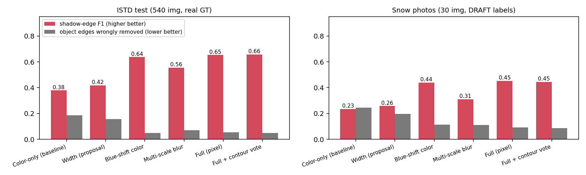

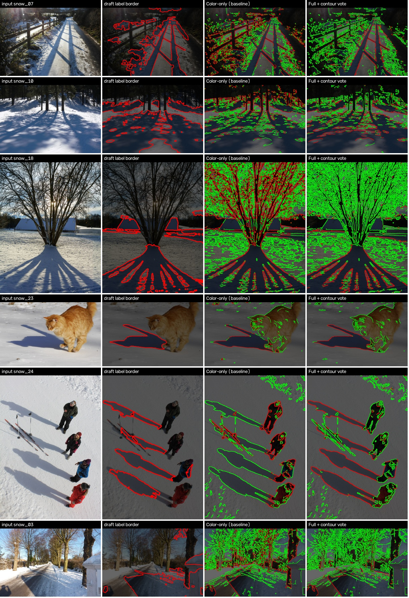

More: summary figures in §3, and the result image for **every** photo in §4.

---

## 1. What is done

| Proposal item | Status | Where |
|---|---|---|
| Collect public shadow data | Done: ISTD test (540) + every 10th training image (133) | `data/ISTD/` (not in git, see §6) |
| Collect snow photos | 30 CC-licensed snow scenes from Wikimedia Commons (own campus photos once it snows) | `data/snow_web/`, `data/CREDITS.md` |
| Label snow photos | Draft masks generated automatically. **Hand correction still to do** | `tools/draft_snow_masks.py`, `tools/label_masks.py` |
| Baseline: Gaussian + Canny, color-only test | Done | `shadow/edges.py`, method `color` |
| Cue 1: cross-edge color check | Done, **redesigned** after measuring it (see §3) | `color_cue`, method `blue` |
| Cue 2: edge sharpness | Done, **redesigned**: multi-scale blur estimate | `multiscale_blur_cue`, method `msblur` |
| Contour-level voting | Done (contours cut at junctions); small gain so far | `contour_vote` |
| Threshold tuning on a training split | Done, grid search | `tune.py` -> `results/params.json` |
| Quantitative evaluation + ablations | Done on ISTD test; snow on draft labels | `eval.py` -> `results/eval_*.csv` |
| Hough line demo | Done | `make_figures.py` |
| Qualitative figures incl. failure cases | Done | `results/figures/` |

**Still to do:** hand-correct the snow masks and re-report snow numbers; take our own
campus photos; scale-adaptive Canny thresholds (snow grain); better voting (vote on
cue values, group straight shadow edges with Hough); an overcast-shadow fallback
(gray shadows have no blue shift); precision-recall curves.

---

## 2. Pipeline and how it maps to the course

Every step uses material from the lectures so far. No learned model: four thresholds
plus one direction vector, all picked on the training split only.

| Step | Course topic | What we do | Code |
|---|---|---|---|
| 0. Working scale | Image formation & sensing | Resize every photo to 640 px on the long side so pixel widths (penumbra size) mean the same thing on every image | `classify.resize_to_work` |
| 1. Smoothing | Image filtering (convolution, Gaussian) | Gaussian blur, sigma 1.4, to suppress noise | `edges.detect_edges` |
| 2. Edges | Edge detection (gradients, Sobel, Canny) | Canny (40/100) for thin, linked edges; Sobel gives the gradient direction at each edge pixel, which tells us which side is dark and which is bright | `edges.detect_edges` |
| 3. Brightness test | Image formation: intensity = reflectance x illumination | A shadow only lowers illumination, so the dark side must be clearly darker (ratio < 0.8) | `cues.color_cue` |
| 4. Color test | Image formation, color / chromaticity | Shadowed ground is lit only by blue skylight, so across a shadow edge the log-chromaticity moves along one fixed sun->sky direction (Finlayson et al.). We test for that shift | `cues.color_cue`, `classify.SHADOW_DIR` |
| 5. Sharpness test | Filtering at several scales, Fourier view (blur = low-pass) | A blurred step loses gradient strength more slowly when smoothed again. From the gradient at sigma 1 and sigma 3 we solve for the edge's own blur width; soft penumbras give a large width | `cues.multiscale_blur_cue` |
| 6. Contour voting | Boundary detection, linking edges into contours | Link edge pixels into 8-connected curves, cut them at junctions, and let each curve take a majority vote | `classify.contour_vote` |
| 7. Downstream demo | Hough transform (HW2) | Line detection on the raw vs. cleaned edge map; count lines on shadow borders | `evaluate.hough_lines` |

The blur formula: a step blurred by width s, smoothed by a Gaussian of std sigma, has
peak gradient proportional to 1/sqrt(s^2 + sigma^2). With r = G(sigma2)/G(sigma1):

    s = sqrt((r^2 * sigma2^2 - sigma1^2) / (1 - r^2))

---

## 3. Results

### Why we changed the proposal's cues

Each cue measured on 2.75 M training edge pixels (red = shadow border, blue = other edges):

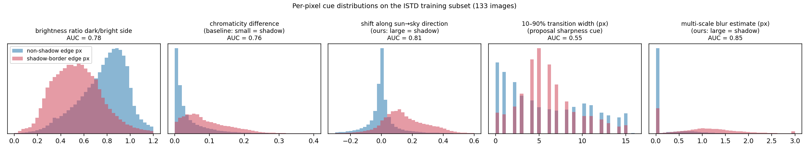

- **"Same chromaticity = shadow" is backwards outdoors.** Shadow borders show *larger*
  chromaticity changes than other edges, because the shadow side turns bluer. Testing
  for the blue shift instead gives AUC 0.81.
- **The 10-90% transition width barely separates the classes (AUC 0.55).** The
  multi-scale blur estimate is the best single cue (AUC 0.85).

### ISTD test set (540 images, real ground truth)

| Method | Precision | Recall | F1 | Object edges wrongly removed | Hough lines | Lines on shadow borders |
|---|---|---|---|---|---|---|
| `canny` (keep all) | - | - | - | 0% | 22,611 | 1,787 |
| `color` (baseline) | 0.28 | 0.58 | 0.38 | 18.7% | 12,597 | 513 |
| `width` (proposal cue) | 0.32 | 0.59 | 0.42 | 15.7% | 13,247 | 417 |
| `blue` | 0.62 | 0.65 | 0.64 | 5.0% | 19,548 | 267 |
| `msblur` | 0.52 | 0.60 | 0.56 | 7.1% | 18,668 | 219 |
| `full` | 0.62 | 0.69 | 0.65 | 5.4% | 19,260 | 158 |
| `full_vote` | 0.63 | 0.69 | **0.66** | 5.0% | 19,324 | 181 |

Scored per Canny edge pixel; a shadow edge = within 3 px of the shadow-mask border.
Each method uses its own best thresholds from the training split.

Green = kept as object edge, red = labeled shadow. Rows: test images at the 90th, 75th
and 50th percentile of per-image F1, then a failure case (a painted mural whose dark
blue regions look like bluish shadows):

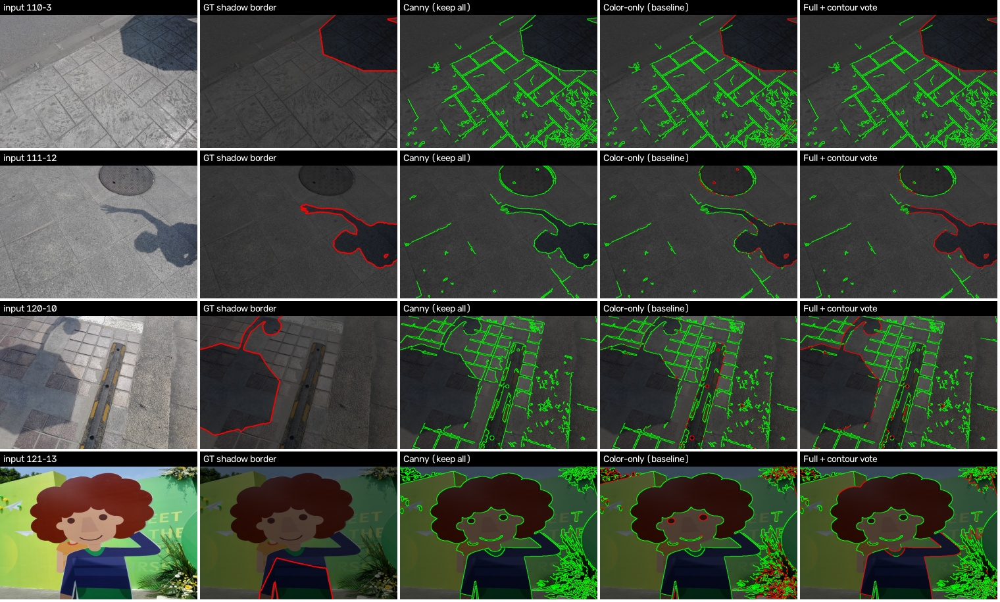

### Hough demo

Left: lines found on raw Canny edges (red = lines on the shadow border). Right: after
removing our shadow edges.

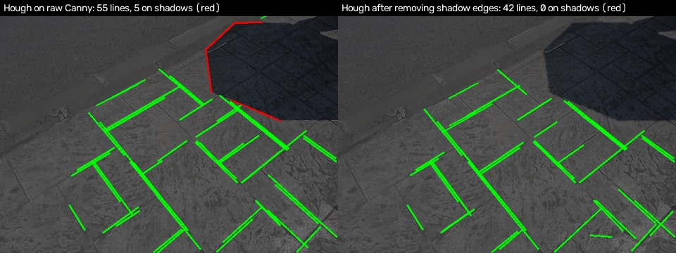

### Snow photos (30 images, DRAFT labels)

Same thresholds as ISTD, no re-tuning. F1: color baseline 0.24, blue 0.44, full 0.45,
full + vote 0.45. These labels are auto-generated drafts, so treat the numbers as
preliminary.


### Problems we hit

- **OpenCV crash on real photos.** `cv2.remap` refuses maps longer than 32,767 px, and a
  real photo has more edge pixels than that. Fixed by laying the samples out as a 2-D grid.
- **Snow texture.** Canny fires on snow grain and branches, which dilutes precision.
- **Dark clothing on snow.** Where a shadow touches a person, the vote can spread red
  onto the body outline.
- **Faint, wide shadows** often produce no Canny edge at all.
- **Contour voting adds little** (+0.004 F1). Cutting at junctions matters, though:
  without the cut, F1 drops to 0.56 on the training split.

---

### Every cue we measured (ISTD training subset, 133 images, 2.75 M edge pixels)

AUC = how well one cue alone separates shadow-border edge pixels from all other edge
pixels (0.5 = useless, 1.0 = perfect). "Direction" says which way a shadow edge points.

| Cue | AUC | Shadow edges (median) | Other edges (median) | Used? |
|---|---|---|---|---|
| Multi-scale blur estimate (px) | **0.85** | 1.02 | 0.00 | yes (`msblur`) |
| Blue shift along sun->sky direction | **0.81** | 0.13 | 0.00 | yes (`blue`) |
| log(B) - log(R) change across edge | 0.81 | 0.18 | 0.00 | folded into blue shift |
| Brightness ratio dark/bright (lower = shadow) | 0.78 | 0.54 | 0.81 | yes (all methods) |
| Chromaticity difference (proposal: small = shadow) | 0.76 **reversed** | 0.077 | 0.020 | baseline only |
| Spread of per-channel log ratios | 0.75 reversed | 0.087 | 0.023 | no |
| Gradient magnitude | 0.65 | 119 | 87 | no |
| 10-90% transition width (px) | 0.55 | 5 | 5 | baseline only (`width`) |
| Texture contrast match (std/mean on both sides) | 0.52 | 0.56 | 0.50 | no, useless |

"Reversed" = the cue works, but in the opposite direction from the proposal's
assumption: shadow edges change color MORE, not less (they turn blue).

### Tuned thresholds (`results/params.json`, from the training split only)

| Method | Thresholds | Train F1 |
|---|---|---|
| `color` | dark ratio < 0.6, chroma diff < 0.3 | 0.348 |
| `width` | dark ratio < 0.6, width > 2 px | 0.361 |
| `blue` | dark ratio < 0.7, blue shift > 0.08 | 0.523 |
| `msblur` | dark ratio < 0.7, blur > 0.8 px | 0.477 |
| `full` | dark ratio < 0.8, blue shift > 0.05, blur > 0.4 px | 0.593 |
| `full_vote` | `full` + contour is shadow if > 60% of its pixels vote shadow | 0.596 |
| darker-only reference (no color/shape cue) | dark ratio < 0.6 | 0.336 |

Shadow direction in (log R/G, log B/G): (-0.526, 0.850), estimated from training
shadow borders. Note the `color` baseline's best chroma threshold (0.3) is so loose
that it is almost the "darker-only" test: the "same color" check adds only +0.012 F1.

### Other experiments (kept out of the final method)

| Experiment | Result | Decision |
|---|---|---|
| Voting without cutting contours at junctions | train F1 0.555 (vs 0.596 with cuts) | keep the cuts |
| Voting on the mean of a soft cue score per contour | train F1 0.51-0.56 | dropped |
| Vote threshold 0.3 / 0.5 / 0.6 | train F1 0.592 / 0.594 / 0.596 | 0.6 |
| Color samples 6 px from the edge instead of 4 | ISTD train 0.597, snow 0.439 | keep 4 px |
| Color samples 8 px from the edge | ISTD train 0.585, snow 0.414 | keep 4 px |
| Processing snow photos at full size (800-960 px) | many penumbras too wide for 4 px sampling | fixed: resize everything to 640 px |

### Synthetic sanity check (`make_synthetic.py`, 6 images)

| Method | P | R | F1 | Object edges removed |
|---|---|---|---|---|
| color | 0.94 | 0.99 | 0.97 | 12.1% |
| width | 0.78 | 0.99 | 0.87 | 57.9% |
| blue | 0.74 | 0.63 | 0.68 | 46.0% |
| msblur | 1.00 | 1.00 | 1.00 | 0.1% |
| full | 0.78 | 0.94 | 0.85 | 55.1% |
| full_vote | 0.78 | 0.98 | 0.87 | 55.3% |

The synthetic images use gray shadows and random-colored boxes, so the color-only
baseline looks almost perfect there, while on real photos it is the worst method.
Lesson: the synthetic set was built on the same wrong assumption as the baseline;
we now only report real data.

### How we got the data

1. ISTD: the official Google Drive link cannot be scripted, so we downloaded the same
   files from a Hugging Face mirror (`CK234/tmp_ISTD`) in the browser: all 540 test
   images + masks and every 10th of the 1,330 training images + masks. Counts match
   the official release.
2. Snow: searched Wikimedia Commons ("shadows on snow", "snowy road shadows", tree
   shadows, Madison snow, ...), downloaded 197 candidates, looked at contact sheets and
   kept 30 snow scenes with clear cast shadows + 3 dry roads. Credits: `data/CREDITS.md`.
3. Snow draft labels: `tools/draft_snow_masks.py` (brightness 20-85% of sunlit snow and
   0.12 bluer in log(B/R), morphology, sky blobs removed). Visually checked; known errors:
   blue roofs and sky, missed gray shadows. To be hand-corrected.

### Questions for the instructor / TA

1. The shadow direction and four thresholds are fit on 133 ISTD training images (test set
   never touched). Does that still count as "training-free", or should the direction come
   from physics (sun vs. sky color temperature) or be estimated per image?
2. Our draft snow labels use a blue-shift rule, which favors our own blue cue. Is hand
   correction enough, or should someone who has not seen the method label from scratch?
3. Per-edge-pixel scoring with a 3 px band: OK, or would you prefer per-contour scores or
   a precision-recall curve?
4. Contour voting gives only +0.004 F1. Worth more time, or focus on snow problems?
5. Should we also run one published deep shadow detector as an upper-bound reference?
6. If there is no sunny snow in Madison before late November, are Commons snow photos OK
   as the main snow test, with our own campus photos on dry pavement?

---

## 4. All results (every image)

Every photo we ran, side by side: **input | color-only baseline | ours (full + contour vote)**.
Green = kept as object edge, red = labeled shadow edge. F1 = shadow-edge F1 for that one image
(snow: against the DRAFT labels). Regenerate with `python make_gallery.py`.

### ISTD test images (12 examples, real ground truth)

**100-1**: baseline F1 0.80, ours F1 0.81

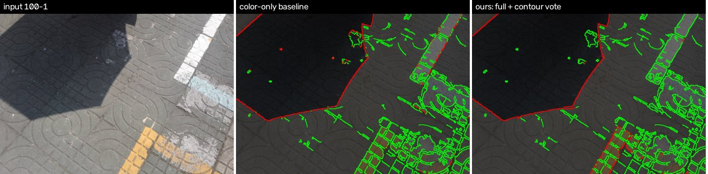

**103-2**: baseline F1 0.53, ours F1 0.83

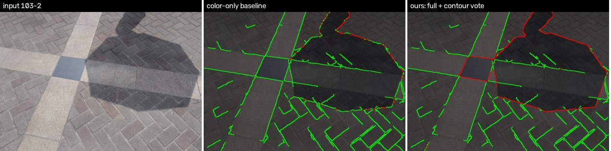

**106-3**: baseline F1 0.89, ours F1 0.94

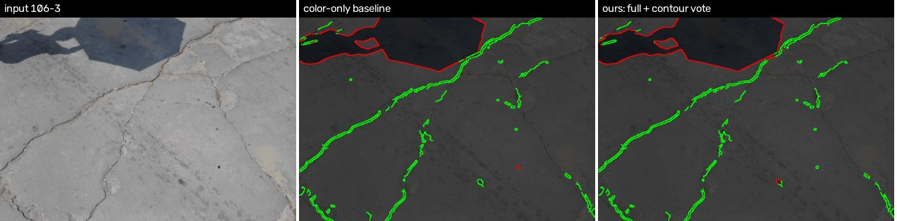

**110-3**: baseline F1 0.91, ours F1 0.97

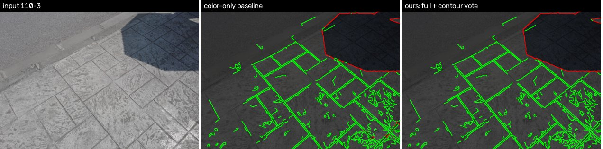

**111-12**: baseline F1 0.49, ours F1 0.90

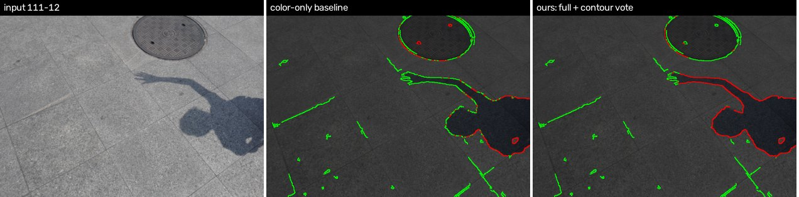

**114-1**: baseline F1 0.09, ours F1 0.26

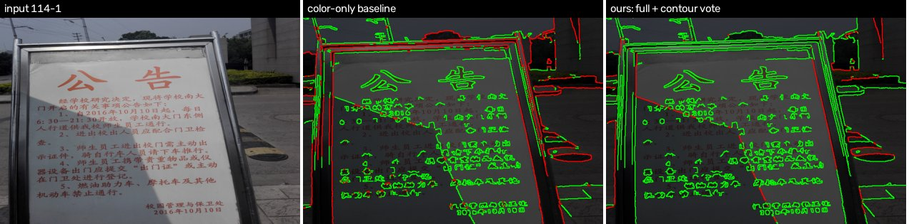

**117-4**: baseline F1 0.82, ours F1 1.00

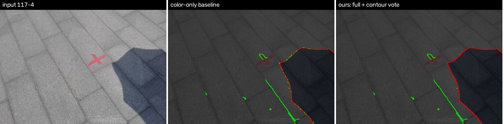

**120-10**: baseline F1 0.10, ours F1 0.72

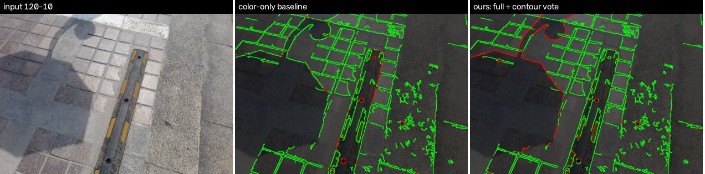

**121-13**: baseline F1 0.02, ours F1 0.13

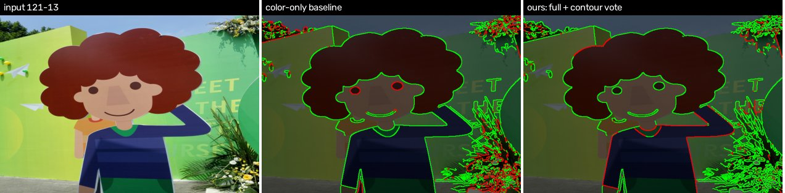

**124-2**: baseline F1 0.09, ours F1 0.41

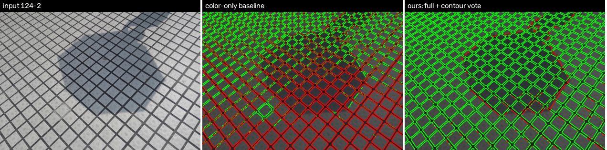

**127-1**: baseline F1 0.17, ours F1 0.37

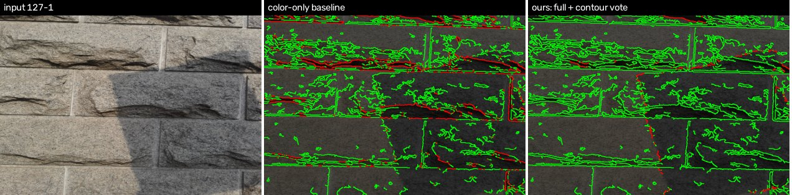

**130-3**: baseline F1 0.67, ours F1 0.86

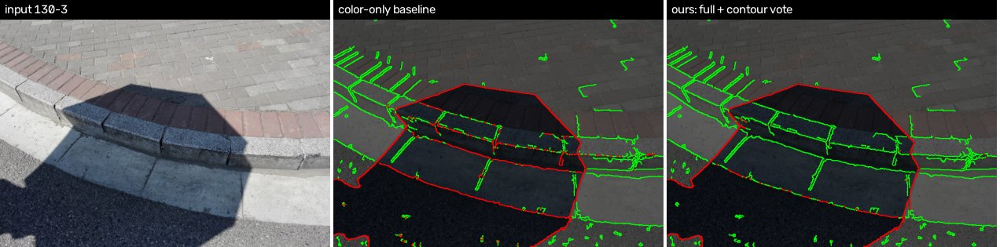

### Snow photos (all 30)

**snow_00**: baseline F1 0.19, ours F1 0.51 (draft labels). Photo: [Curve and stripes.jpg](https://commons.wikimedia.org/wiki/File:Curve_and_stripes.jpg), Maasaak, CC BY-SA 4.0

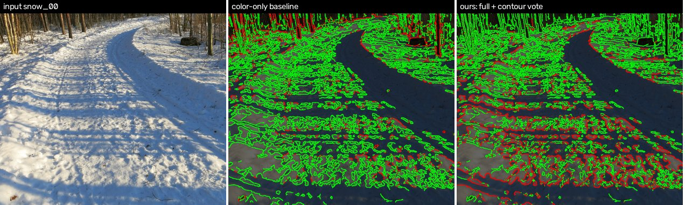

**snow_01**: baseline F1 0.22, ours F1 0.40 (draft labels). Photo: [Snowy Shadows (4359488535).jpg](https://commons.wikimedia.org/wiki/File:Snowy_Shadows_(4359488535).jpg), Michael from Calgary, AB, Canada, CC BY 2.0

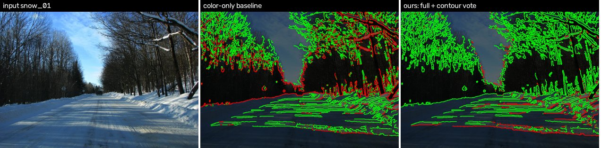

**snow_02**: baseline F1 0.26, ours F1 0.60 (draft labels). Photo: [Kanata Winter (3240572735).jpg](https://commons.wikimedia.org/wiki/File:Kanata_Winter_(3240572735).jpg), missbossy from Singapore, Singapore, CC BY 2.0

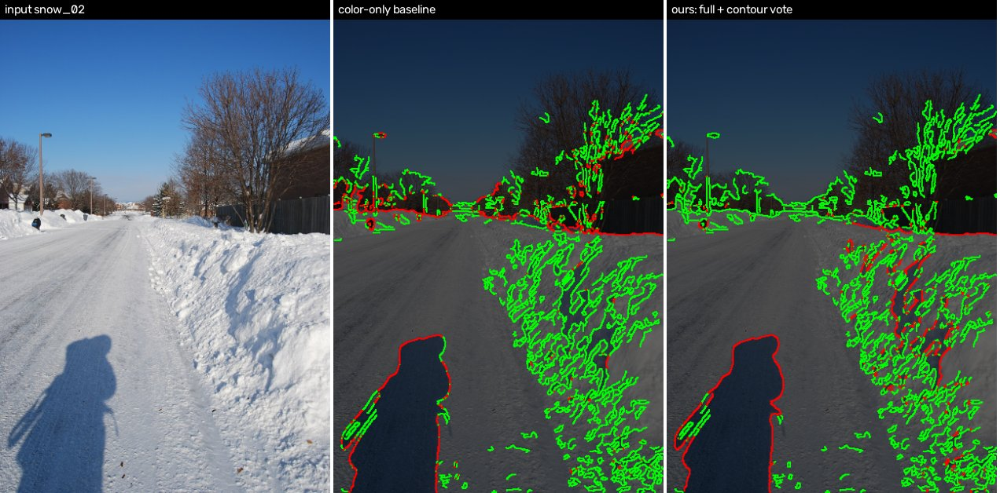

**snow_03**: baseline F1 0.17, ours F1 0.25 (draft labels). Photo: [Pollarded avenue of trees, snow and long shadows - geograph.org.uk - 1651017.jpg](https://commons.wikimedia.org/wiki/File:Pollarded_avenue_of_trees,_snow_and_long_shadows_-_geograph.org.uk_-_1651017.jpg), Peter Barr, CC BY-SA 2.0

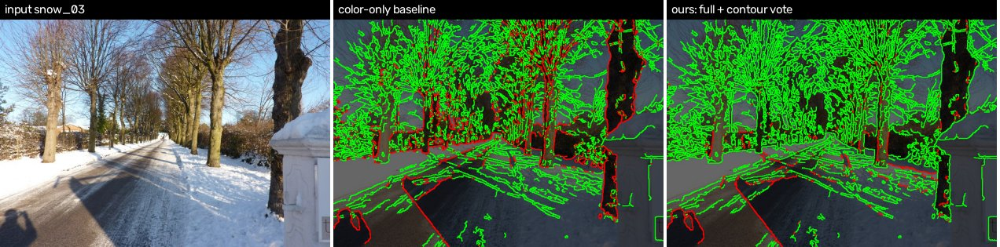

**snow_04**: baseline F1 0.21, ours F1 0.29 (draft labels). Photo: [Tree shadows, Gortaclare - geograph.org.uk - 4793418.jpg](https://commons.wikimedia.org/wiki/File:Tree_shadows,_Gortaclare_-_geograph.org.uk_-_4793418.jpg), Kenneth Allen, CC BY-SA 2.0

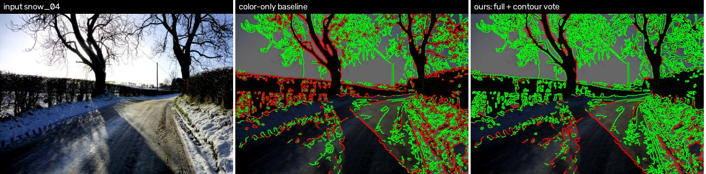

**snow_05**: baseline F1 0.17, ours F1 0.12 (draft labels). Photo: [Tree shadows in the snow, Garvaghy - geograph.org.uk - 6389674.jpg](https://commons.wikimedia.org/wiki/File:Tree_shadows_in_the_snow,_Garvaghy_-_geograph.org.uk_-_6389674.jpg), Kenneth Allen, CC BY-SA 2.0

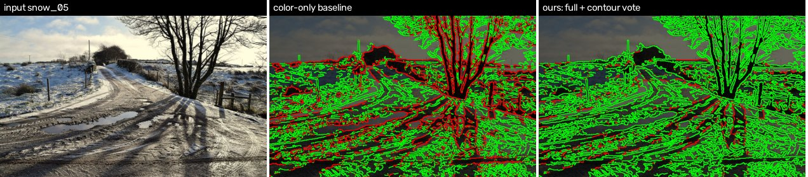

**snow_06**: baseline F1 0.09, ours F1 0.38 (draft labels). Photo: [Tree shadows along Augher Point Road - geograph.org.uk - 7428506.jpg](https://commons.wikimedia.org/wiki/File:Tree_shadows_along_Augher_Point_Road_-_geograph.org.uk_-_7428506.jpg), Kenneth Allen, CC BY-SA 2.0

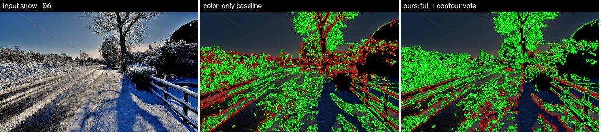

**snow_07**: baseline F1 0.37, ours F1 0.48 (draft labels). Photo: [Shadows on the snow - geograph.org.uk - 1651063.jpg](https://commons.wikimedia.org/wiki/File:Shadows_on_the_snow_-_geograph.org.uk_-_1651063.jpg), Roger Cornfoot, CC BY-SA 2.0

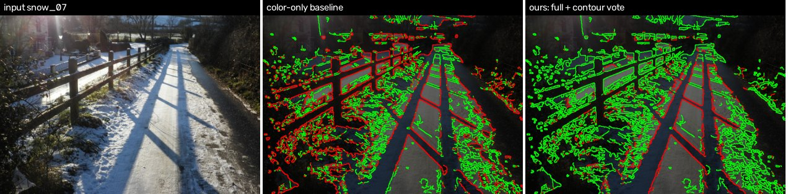

**snow_08**: baseline F1 0.36, ours F1 0.48 (draft labels). Photo: [Snow and shadows (3266886793).jpg](https://commons.wikimedia.org/wiki/File:Snow_and_shadows_(3266886793).jpg), Tim Green from Bradford, CC BY 2.0

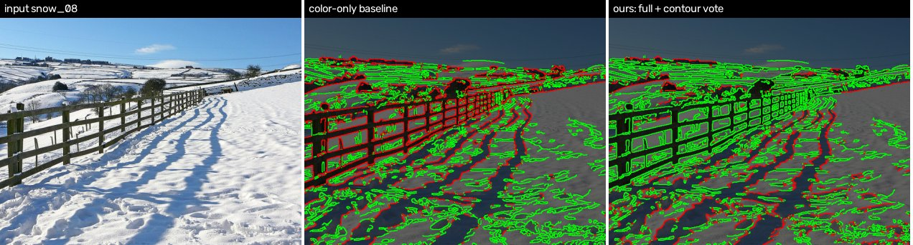

**snow_09**: baseline F1 0.20, ours F1 0.31 (draft labels). Photo: [Shadows on the snow - geograph.org.uk - 7359532.jpg](https://commons.wikimedia.org/wiki/File:Shadows_on_the_snow_-_geograph.org.uk_-_7359532.jpg), Graham Hogg, CC BY-SA 2.0

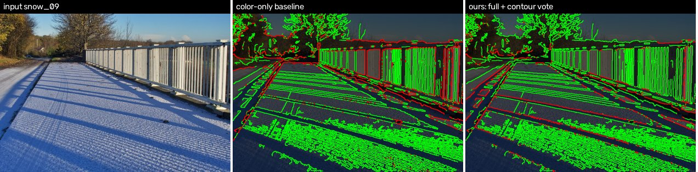

**snow_10**: baseline F1 0.46, ours F1 0.55 (draft labels). Photo: [Pinus Ponderosa Shadow 70226.JPG](https://commons.wikimedia.org/wiki/File:Pinus_Ponderosa_Shadow_70226.JPG), Wars, CC BY-SA 3.0

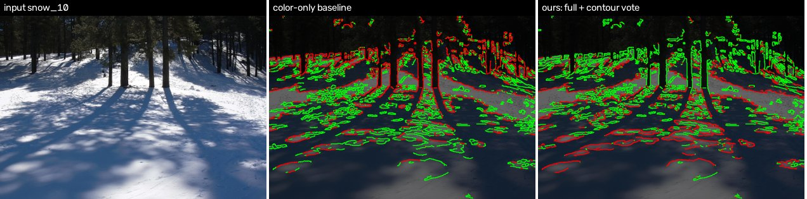

**snow_11**: baseline F1 0.23, ours F1 0.50 (draft labels). Photo: [010 Winter am Orankesee.jpg](https://commons.wikimedia.org/wiki/File:010_Winter_am_Orankesee.jpg), Geoprofi Lars, CC BY-SA 4.0

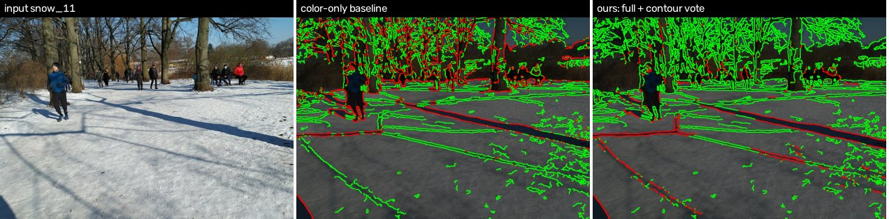

**snow_12**: baseline F1 0.24, ours F1 0.36 (draft labels). Photo: [Schnee am Obersee (1).jpg](https://commons.wikimedia.org/wiki/File:Schnee_am_Obersee_(1).jpg), Geoprofi Lars, CC BY-SA 4.0

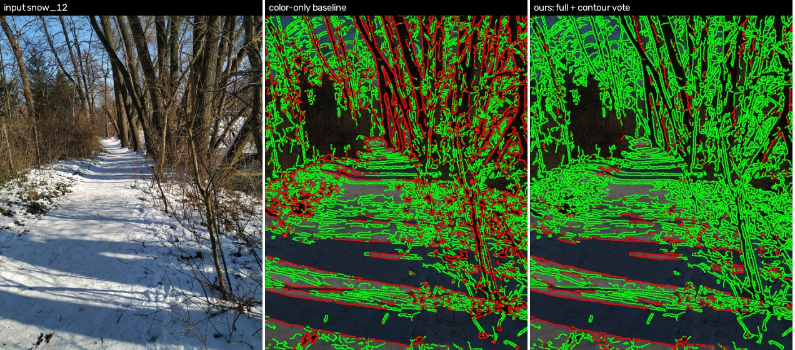

**snow_13**: baseline F1 0.12, ours F1 0.27 (draft labels). Photo: [Schnee am Obersee (2).jpg](https://commons.wikimedia.org/wiki/File:Schnee_am_Obersee_(2).jpg), Geoprofi Lars, CC BY-SA 4.0

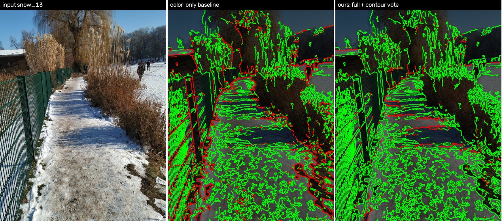

**snow_14**: baseline F1 0.23, ours F1 0.50 (draft labels). Photo: [Tree Shadows in the Snow - geograph.org.uk - 1161074.jpg](https://commons.wikimedia.org/wiki/File:Tree_Shadows_in_the_Snow_-_geograph.org.uk_-_1161074.jpg), David Lally, CC BY-SA 2.0

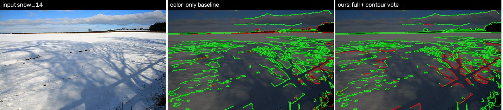

**snow_15**: baseline F1 0.06, ours F1 0.40 (draft labels). Photo: [Long shadows on the snow - geograph.org.uk - 1658044.jpg](https://commons.wikimedia.org/wiki/File:Long_shadows_on_the_snow_-_geograph.org.uk_-_1658044.jpg), Richard Humphrey, CC BY-SA 2.0

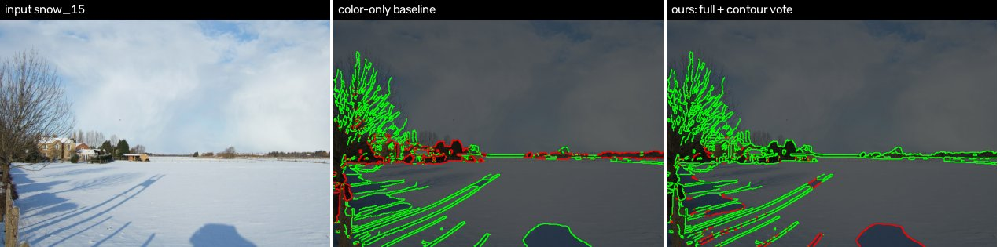

**snow_16**: baseline F1 0.06, ours F1 0.30 (draft labels). Photo: [Snow and shadows - geograph.org.uk - 1651052.jpg](https://commons.wikimedia.org/wiki/File:Snow_and_shadows_-_geograph.org.uk_-_1651052.jpg), Dave Croker, CC BY-SA 2.0

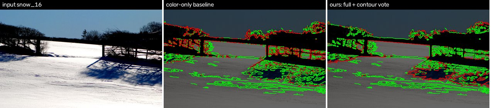

**snow_17**: baseline F1 0.00, ours F1 0.06 (draft labels). Photo: [Snow shadows , , Snöskuggor - Flickr - northofsweden.jpg](https://commons.wikimedia.org/wiki/File:Snow_shadows_,_,_Sn%C3%B6skuggor_-_Flickr_-_northofsweden.jpg), northofsweden from Sweden, CC BY 2.0

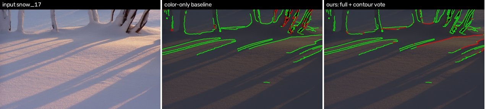

**snow_18**: baseline F1 0.27, ours F1 0.63 (draft labels). Photo: [Tree shadow on snow in Tuntorp.jpg](https://commons.wikimedia.org/wiki/File:Tree_shadow_on_snow_in_Tuntorp.jpg), W.carter, CC BY-SA 4.0

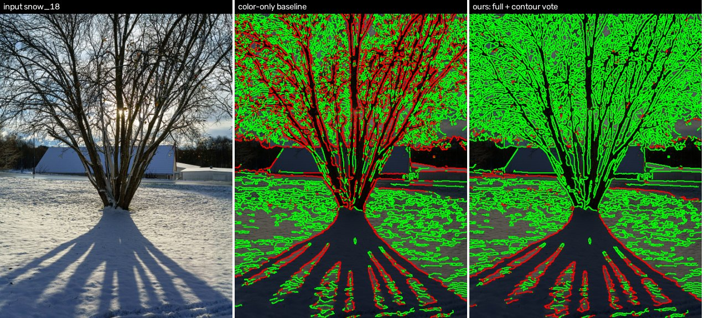

**snow_19**: baseline F1 0.21, ours F1 0.45 (draft labels). Photo: [Shadows on the snow - geograph.org.uk - 5672535.jpg](https://commons.wikimedia.org/wiki/File:Shadows_on_the_snow_-_geograph.org.uk_-_5672535.jpg), Richard Sutcliffe, CC BY-SA 2.0

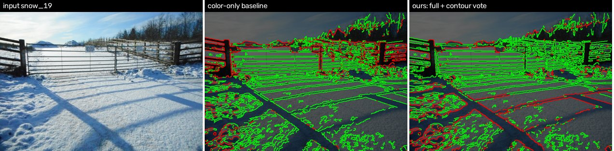

**snow_20**: baseline F1 0.23, ours F1 0.41 (draft labels). Photo: [Tree shadows on the snow near to Brickkiln Cottage - geograph.org.uk - 6061275.jpg](https://commons.wikimedia.org/wiki/File:Tree_shadows_on_the_snow_near_to_Brickkiln_Cottage_-_geograph.org.uk_-_6061275.jpg), Peter S, CC BY-SA 2.0

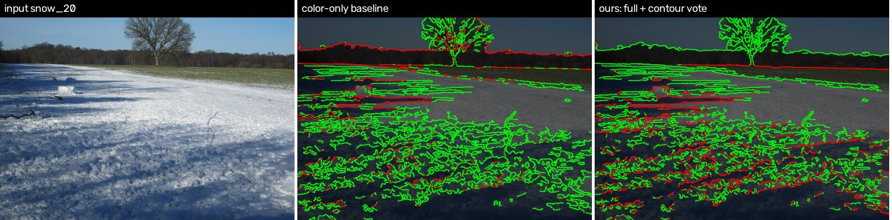

**snow_21**: baseline F1 0.14, ours F1 0.35 (draft labels). Photo: [Snow shadows, Trent Park, London N14 - geograph.org.uk - 1790851.jpg](https://commons.wikimedia.org/wiki/File:Snow_shadows,_Trent_Park,_London_N14_-_geograph.org.uk_-_1790851.jpg), Christine Matthews, CC BY-SA 2.0

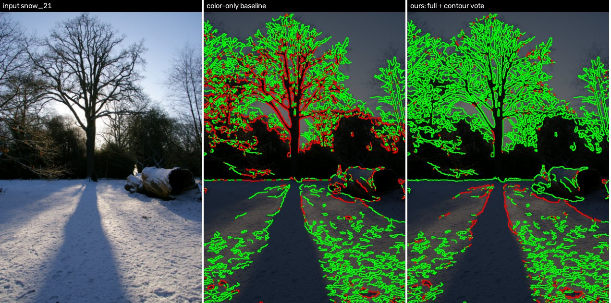

**snow_22**: baseline F1 0.16, ours F1 0.20 (draft labels). Photo: [Long shadows and weasel tracks near a lone tree.jpg](https://commons.wikimedia.org/wiki/File:Long_shadows_and_weasel_tracks_near_a_lone_tree.jpg), Jacob W. Frank, Public domain

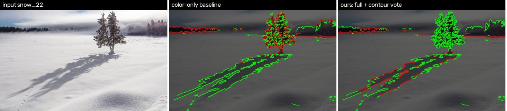

**snow_23**: baseline F1 0.56, ours F1 0.91 (draft labels). Photo: [Gillie in the snow (383804324).jpg](https://commons.wikimedia.org/wiki/File:Gillie_in_the_snow_(383804324).jpg), Dwight Sipler from Stow, MA, USA, CC BY 2.0

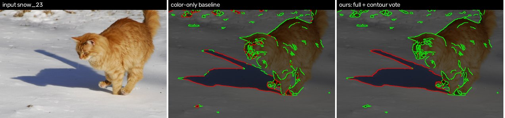

**snow_24**: baseline F1 0.17, ours F1 0.72 (draft labels). Photo: [Skyggemennesker i snøen.JPG](https://commons.wikimedia.org/wiki/File:Skyggemennesker_i_sn%C3%B8en.JPG), Øyvind Holmstad, CC BY-SA 3.0

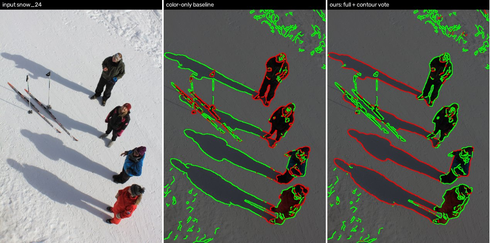

**snow_25**: baseline F1 0.33, ours F1 0.80 (draft labels). Photo: [Lobster lift shadows.jpg](https://commons.wikimedia.org/wiki/File:Lobster_lift_shadows.jpg), internets_dairy, CC BY 2.0

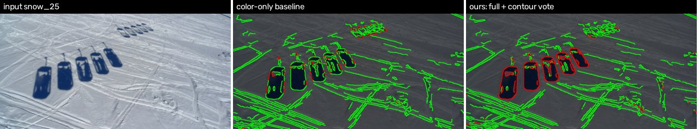

**snow_26**: baseline F1 0.01, ours F1 0.01 (draft labels). Photo: [Gaudi's Staircase (16007531644).jpg](https://commons.wikimedia.org/wiki/File:Gaudi%27s_Staircase_(16007531644).jpg), Michael Pardo from Niagara, Canada, CC BY 2.0

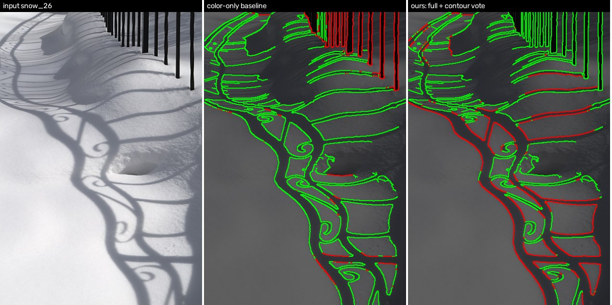

**snow_27**: baseline F1 0.07, ours F1 0.33 (draft labels). Photo: [Sunny day in winter ,.jpg](https://commons.wikimedia.org/wiki/File:Sunny_day_in_winter_,.jpg), Vitold Muratov, CC BY-SA 4.0

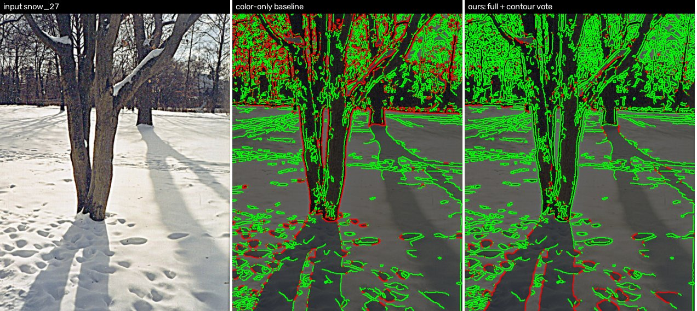

**snow_28**: baseline F1 0.18, ours F1 0.47 (draft labels). Photo: [Тень от куста.jpg](https://commons.wikimedia.org/wiki/File:%D0%A2%D0%B5%D0%BD%D1%8C_%D0%BE%D1%82_%D0%BA%D1%83%D1%81%D1%82%D0%B0.jpg), Vitaliy VK, CC BY-SA 4.0

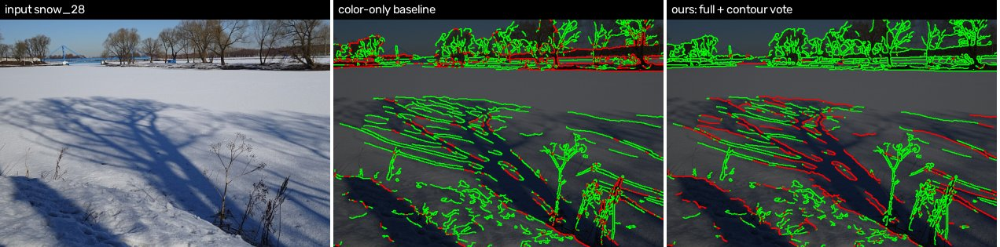

**snow_29**: baseline F1 0.59, ours F1 0.65 (draft labels). Photo: [Следы на снегу 04.jpg](https://commons.wikimedia.org/wiki/File:%D0%A1%D0%BB%D0%B5%D0%B4%D1%8B_%D0%BD%D0%B0_%D1%81%D0%BD%D0%B5%D0%B3%D1%83_04.jpg), Vitaliy VK, CC BY-SA 4.0

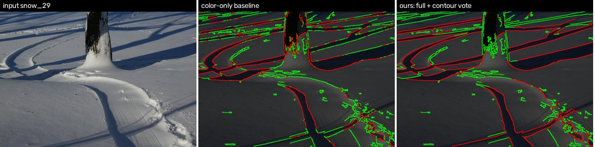

### Dry-road photos (no labels, qualitative only)

**dry_00**. Photo: [Shadows on snowy road, Barton - geograph.org.uk - 1692986.jpg](https://commons.wikimedia.org/wiki/File:Shadows_on_snowy_road,_Barton_-_geograph.org.uk_-_1692986.jpg), Derek Harper, CC BY-SA 2.0

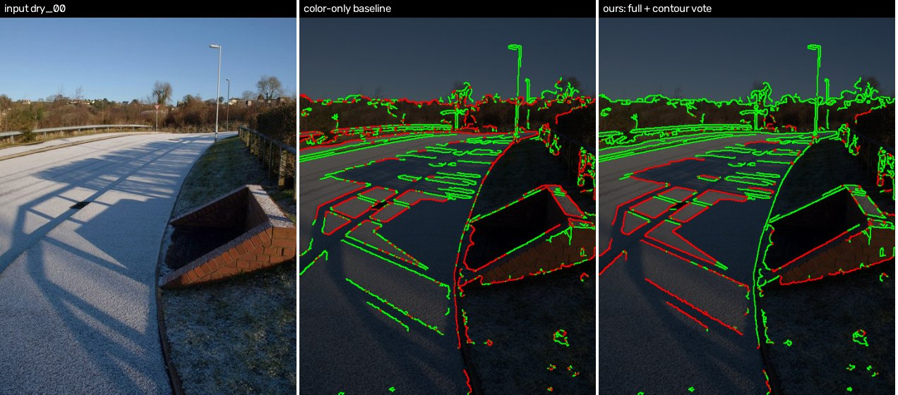

**dry_01**. Photo: [The Avenue, shadows and winter branches - geograph.org.uk - 6402137.jpg](https://commons.wikimedia.org/wiki/File:The_Avenue,_shadows_and_winter_branches_-_geograph.org.uk_-_6402137.jpg), John Sutton, CC BY-SA 2.0

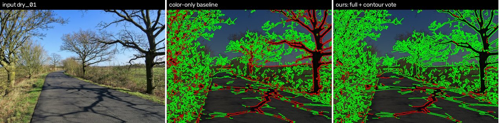

**dry_02**. Photo: [Lichfield Road, a tree's shadow - geograph.org.uk - 7951928.jpg](https://commons.wikimedia.org/wiki/File:Lichfield_Road,_a_tree%27s_shadow_-_geograph.org.uk_-_7951928.jpg), John Sutton, CC BY-SA 2.0

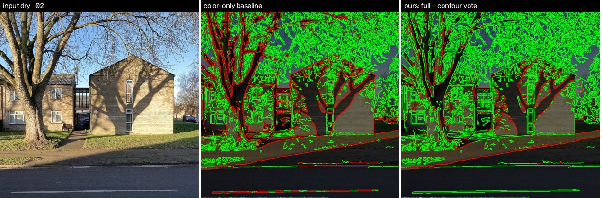

---

## 5. Methods (`--method`)

| name | what it does |
|---|---|
| `canny` | baseline: keep every edge |
| `color` | color-only baseline: darker + same chromaticity on both sides |
| `width` | proposal sharpness cue: 10-90% transition wider than `WIDTH_T` |
| `blue` | darker + chromaticity shifts along the sun->skylight direction |
| `msblur` | darker + multi-scale blur estimate above `BLUR_T` (soft penumbra) |
| `full` | `blue` AND `msblur`, per pixel |
| `full_vote` | `full` + majority vote per contour (contours cut at junctions) |

## 6. Code

- `shadow/edges.py` - Gaussian blur + Canny + gradient direction
- `shadow/cues.py` - cross-edge color, transition width, multi-scale blur, texture contrast
- `shadow/classify.py` - working scale, thresholds, combining cues, contour voting
- `shadow/evaluate.py` - ground-truth border band, P/R/F1, Hough lines
- `tune.py` - shadow direction + threshold grid search on the training split
- `eval.py` - all methods on a folder of images + masks -> CSV
- `run.py` - overlays for any image or folder
- `make_figures.py` - summary figures in `results/figures/` (needs matplotlib)
- `make_gallery.py` - one side-by-side result image per photo in `results/gallery/`
- `tools/draft_snow_masks.py`, `tools/label_masks.py` - draft snow labels + hand-labeling tool

## 7. Setup and reproduction (macOS)

```bash
cd snowy-road-detector
python3 -m venv .venv
source .venv/bin/activate
pip install -r requirements.txt
pip install matplotlib          # only for make_figures.py
```

Quick check, no dataset needed:

```bash
python make_synthetic.py
python eval.py --images data/synthetic/images --masks data/synthetic/masks
python run.py data/synthetic/images/syn_1.png    # overlays in results/
```

**ISTD.** The official copy is on Google Drive (ST-CGAN repo,
https://github.com/DeepInsight-PCALab/ST-CGAN). We used an unofficial mirror with the same
files on Hugging Face (`CK234/tmp_ISTD`). Put the test set in `data/ISTD/test/{test_A,test_B}`
and every 10th training image in `data/ISTD/train/{train_A,train_B}` (gitignored, 370 MB).

Full reproduction (about 1.5 minutes):

```bash
python tune.py --images data/ISTD/train/train_A --masks data/ISTD/train/train_B
python eval.py --images data/ISTD/test/test_A --masks data/ISTD/test/test_B --out results/eval_istd_test.csv
python eval.py --images data/snow_web --masks data/snow_masks_draft --out results/eval_snow_draft.csv
python make_figures.py
python make_gallery.py
```

Hand-correcting the snow labels (saves to `data/snow_masks/`):

```bash
python tools/label_masks.py data/snow_web data/snow_masks_draft data/snow_masks
```

Our own photos: put them in `data/own/`, then `python run.py data/own/ --method full_vote`.
